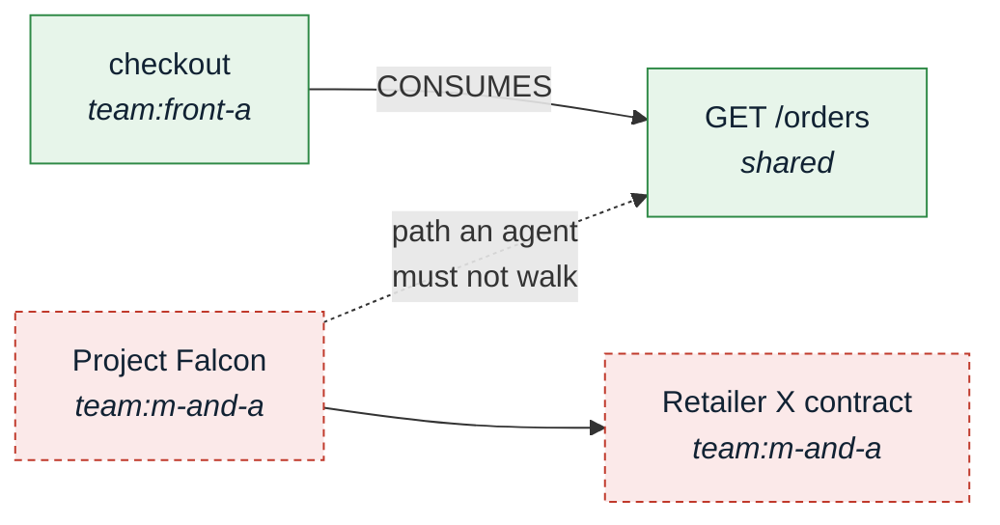
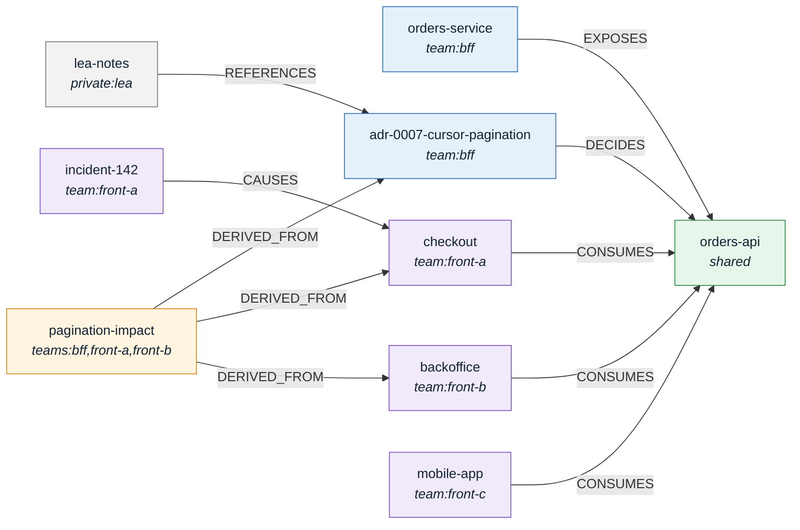
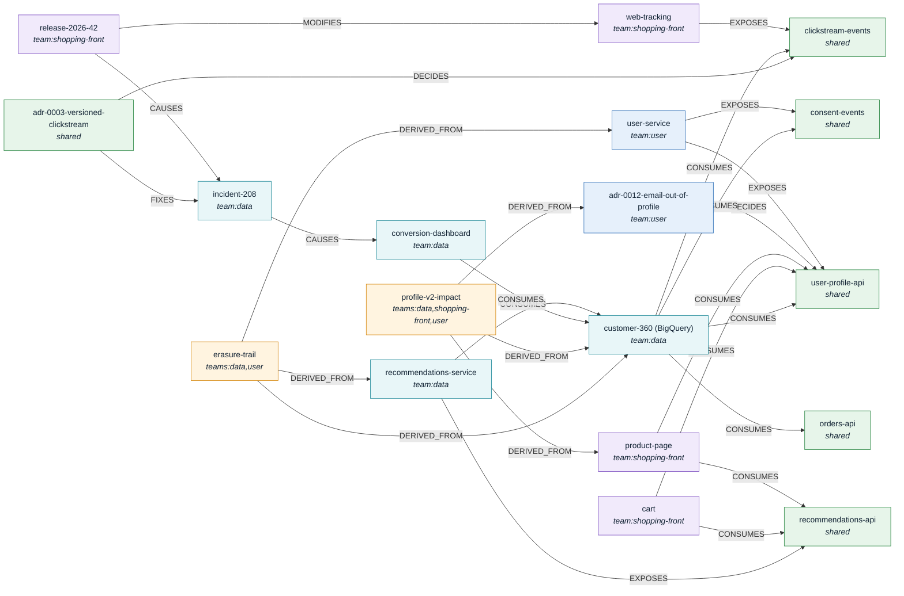
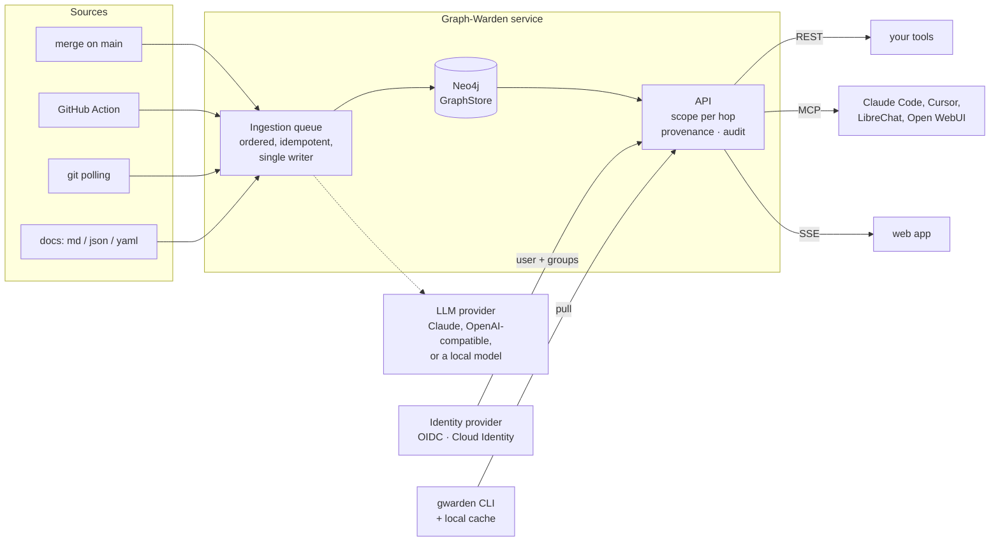
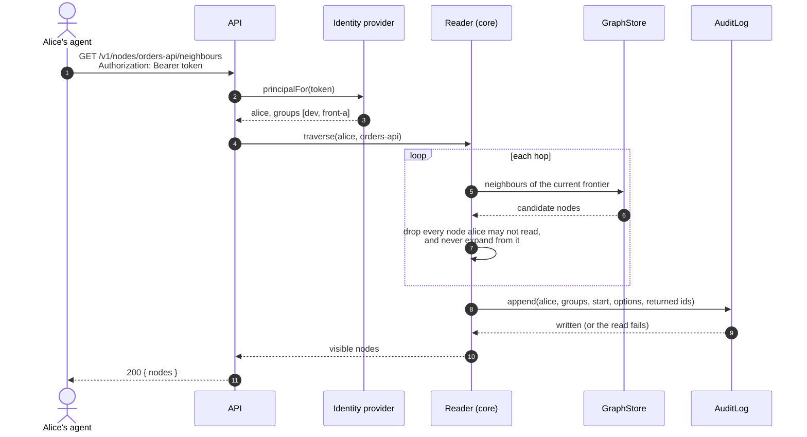
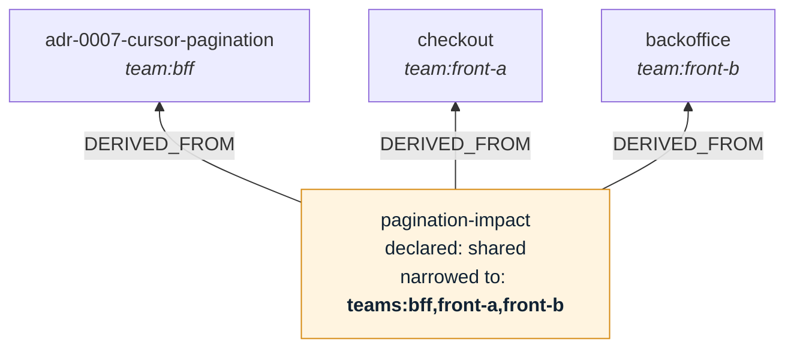
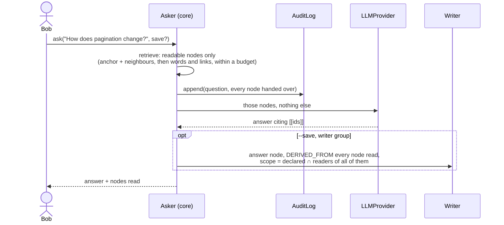
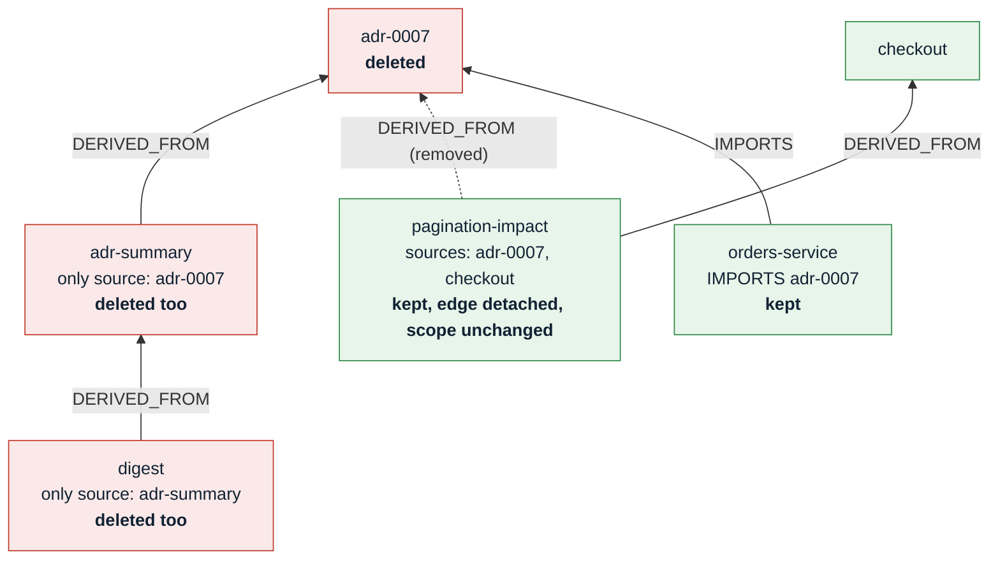
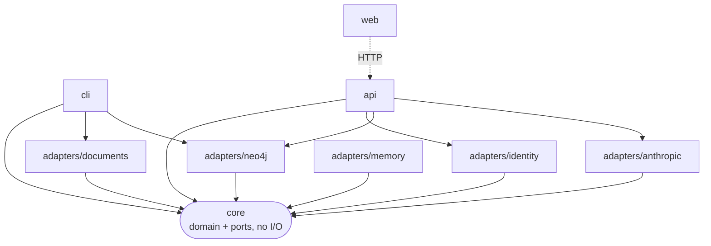

<p align="center">
  <picture>
    <source media="(prefers-color-scheme: dark)" srcset="docs/assets/banner-dark.png">
    
  </picture>
</p>

<p align="center"><b>English</b> · <a href="README.fr.md">Français</a></p>

# Graph-Warden

**One knowledge graph for every team's AI agents, with rights checked on every hop.**

Graph-Warden collects what teams already write (repositories, API specs, docs, agent sessions), links it into one typed graph, and lets AI agents query it. Every query is made on behalf of a person, returns only what that person may see, and is recorded.

> Status: **alpha**. Milestone M0 is done; M1 and M2 are in progress. Nothing here is ready for production. See [what works today](#what-works-today) and the [roadmap](docs/ROADMAP.md).

**Reading guide.** The [first part](#part-1--the-product) is for anyone deciding whether this is useful: the problem, who it is for, a demo. The [second part](#part-2--under-the-hood) is for anyone building or running it: architecture, how a read is checked, how to run it.

| Part 1 — The product | Part 2 — Under the hood |
|---|---|
| [The problem](#the-problem) | [Architecture](#architecture) |
| [An example](#an-example-one-endpoint-four-teams) | [Scopes](#scopes) |
| [What it guarantees](#what-it-guarantees) | [The ontology](#the-ontology) |
| [Who it is for](#who-it-is-for) | [Anatomy of a read](#anatomy-of-a-read) |
| [See it run](#see-it-run) | [Derived scopes](#derived-scopes) |
| [Ask and delete](#ask-and-delete) | [Asking the graph](#asking-the-graph) |
| [How it differs](#how-it-differs) | [Deleting a node](#deleting-a-node) |
| [What works today](#what-works-today) | [Quick start](#quick-start) |
| | [Repository layout](#repository-layout) |
| | [Contributing](#contributing) |

---

# Part 1 — The product

## The problem

A large organisation wants its AI agents to know what the organisation knows. Today it has two options, and both are bad:

- **Open everything.** One team's agent reads HR files, security incidents, M&A notes and customer data that are none of its business.
- **Wall every team off.** Each team gets its own silo, and everything that crosses teams is lost — which is exactly where agents would help most.

Graph-Warden is the third option: **one shared graph, with access decided on every read.**

Filtering the final answer is not enough. In a graph, the path itself leaks information:



An agent working for a front-end developer may walk from `checkout` to `GET /orders`. It must not walk on to `Project Falcon`, and must not even learn that it exists because a path ran through it. Graph-Warden checks rights **before each step**, not on the final result.

## An example: one endpoint, four teams

The BFF team is about to change how `GET /orders` paginates. Three front-end teams consume it.

- **Bob** (BFF team) asks his agent what depends on the endpoint. He sees his service and his decision record, not the front-end teams' internal notes.
- **Alice** (front-end team A) sees her checkout module and the incident it caused last month, not the BFF's internals.
- **Lea** (lead) sees all of it, plus an impact summary written for the leads from the three teams' documents.
- **Bob does not see that summary**, even though it was published as "shared": it is built from documents he may not read, so Graph-Warden narrows it automatically.
- **The DPO** can list every read any agent made, and when. Bob cannot.

One graph, five people, five correct views — and nobody configured a filter for any of them. The [demo](#see-it-run) runs exactly this.

## What it guarantees

| Guarantee | In plain words |
|---|---|
| **Per-step access** | An agent never walks through something its user may not see, so nothing is inferred through it. |
| **Summaries inherit their sources** | A summary built from three teams' documents is readable only by people who may read all three. |
| **Private by default** | A document nobody scoped stays private to whoever added it. Sharing is always a decision. |
| **One door** | Agents and tools reach the graph only through the API. Nobody queries the database directly. |
| **Every read is recorded** | Who asked, with which groups, for what, and what came back. If the record cannot be written, the read fails. |
| **Answers stay within your rights** | An AI answer is written only from what you may read, and a saved answer is visible only to people who may read everything it was written from. |
| **Deletion follows summaries** | Deleting a document deletes the summaries built only from it, and only unlinks those built from other documents too. You see the full list and type the name before anything goes. |
| **Your directory decides** | Users and groups come from your identity provider (Entra ID, Okta, Keycloak, Google Workspace…). No second user base to maintain. |
| **Erasure of a whole source** | Erasing a source (GDPR article 17) applies the same deletion to every document it brought in. |

## Who it is for

- **Security teams: agents that do not leak.** Rights are checked on every step of a traversal, not only on the result.
- **Engineering teams: cross-team impact before the merge.** When the BFF team changes an endpoint, the front-end teams that consume it are told in the pull request, before it breaks in production, by a GitHub Action that comments the pull request.
- **Data protection and audit: compliance built in.** Every read an agent makes on behalf of a user is recorded, and erasure reaches everything an LLM derived from the erased source.
- **Infrastructure teams: it fits a large group's constraints.**
  - Self-hosted, on GCP, Azure or on premises.
  - Developer machines open no inbound port: they pull the part of the graph their user may see.
  - No tunnel, and SSE rather than WebSocket, so corporate proxies let it through.
  - Apache-2.0, which legal teams accept where they often block the AGPL.
  - Any model, including a local one for sensitive sources.

## See it run

The demo is the example above, on a sample shop. Its graph:



Three more teams, Shopping-Front, User and Data, share four contracts. Data's BigQuery table reads from all of them, the orders endpoint included:



| Person | Groups (from the directory) |
|---|---|
| Bob | `dev`, `bff` |
| Alice | `dev`, `front-a` |
| Carla | `dev`, `front-c` |
| Lea | `dev`, `dev-leads`, and through it every team group |
| Marie | `dev`, `shopping-front` |
| Yanis | `dev`, `user` |
| Sofia | `dev`, `data` |
| DPO | `auditors` |

It needs only Docker:

```sh
docker compose --profile demo up -d --build --wait
examples/shop/demo.sh
```

**1. Same question, same graph, four answers.** Bob sees the BFF side of the endpoint, Alice her module and its incident, Carla only the mobile app. Lea, a lead, sees everything around it, including her own private notes.

<p align="center"></p>

**2. A summary takes the scope of all its sources.** Bob is in `bff` but not in `front-a` or `front-b`, so the impact summary does not exist for him. Lea reads it and its sources.

<p align="center"></p>

**3. Pull into a local cache.** Alice's machine opens no port: it pulls a SQLite cache that holds only what she may see, and later pulls only the changes.

<p align="center"></p>

**4. An endpoint is a contract between teams.** Release 2026.42 of the web shop renamed `add_to_cart` to `cart_add`; Data's conversion funnel dropped 31% with flat sales (INC-208), and the two teams wrote ADR 0003, a versioned clickstream contract. Marie sees the release and the ADR, Sofia the incident and the ADR, neither the other team's document. Lea sees the whole chain.

<p align="center"></p>

**5. Profile v2, across three teams.** ADR 0012 takes `email` out of the user profile after a GDPR audit finding. It breaks the product page's newsletter prefill and the CRM matching of `customer_360`. The leads' impact summary is derived from User, Shopping-Front and Data documents: Yanis, who wrote the ADR, is only in `user` and does not get it. `erasure-trail`, the answer to "where is an erased customer still?", is narrowed the same way to `teams:data,user`.

<p align="center"></p>

**6. Every read is recorded.** Bob may not read the audit log, and his attempt is itself recorded. The DPO may.

<p align="center"></p>

The demo API uses fixed tokens (`examples/shop/users.yaml`) and listens on localhost only. Stop it with `docker compose --profile demo down`.

## Ask and delete

**Ask a question, get an answer with sources.** `gwarden ask "How does the orders pagination change?"` answers from the documents you may read, and cites them. Bob and Lea asking the same question get different answers, because they may read different things. With `--save`, the answer becomes a page of the graph that others can find — visible only to those who may read everything it was written from.

**Delete without leaving orphans, and without collateral damage.** `gwarden delete adr-0007-cursor-pagination` shows what goes before anything does; here, with a summary written only from that decision:

```text
Deleting adr-0007-cursor-pagination removes:
  Decision  adr-0007-cursor-pagination  [team:bff]
  Concept   adr-summary  [team:bff]  derived only from deleted nodes
and detaches, keeping these nodes, their other sources and their scope:
  pagination-impact -DERIVED_FROM-> adr-0007-cursor-pagination

Are you sure? It will delete 2 entries from adr-0007-cursor-pagination.
Type adr-0007-cursor-pagination to confirm:
```

Only members of a writer group may delete or save answers, and only what they may read. If the graph changed between the preview and the confirmation, nothing is deleted.

## In the browser

The API also serves a web app: each node as a page (title, scope, provenance, text, what it derives from and what links to it), search, the graph itself, questions, wiki pages written in the browser, and the past: a repository as it was at a commit, and a pull request's impact drawn as a highlighted subgraph (with `GWARDEN_REPOSITORIES` pointing at the worker's clones). A past node is shown only to who may read it both then and now. It shows what its user may read, nothing else, and updates as the graph changes. In the demo, open http://localhost:8080 and sign in with a token from `examples/shop/users.yaml`.

<p align="center"></p>

The same graph, for Lea (every team) and for Bob (BFF only):

<p align="center">
  
  
</p>

Signing in goes through your identity provider; the browser never holds a token. Wiki pages follow the same rules as everything else: only writers save them, only into a scope they read, and a save made over someone else's newer version is refused instead of overwriting it.

## How it differs

Graph databases already have role-based access, and agent-memory libraries already scope memories by user. What they leave open is what happens between the agent and the knowledge:

- paths that leak through nodes the reader may not see;
- LLM-written summaries that are more visible than their sources;
- erasure that stops at the original document;
- changes in one team that silently break another.

## What works today

- the typed ontology (Zod), extended by configuration with an organisation's own types, and a Neo4j graph store;
- ingestion of Markdown, JSON and YAML documents with typed references, private by default;
- traversal with scopes checked on every hop; derived documents readable only by those who read all their sources;
- a REST API whose identities and groups come from an OIDC provider or Google with Cloud Identity;
- an audit entry for every read, question and deletion;
- `gwarden pull` into a local SQLite cache holding only what the user may see;
- retrieval ranked by BM25 and the graph's links, on the readable part only, within a budget of tokens: a hidden document changes neither what a reader gets nor its order, which property tests check ([proposal 0013](docs/proposals/0013-graph-ranked-retrieval.md));
- `gwarden ask`, answers from readable nodes with Claude (Claude API, Vertex AI or Google Cloud, and Microsoft Foundry, the last three with no API key) or any OpenAI-compatible model, local ones included, filed back as derived nodes on request;
- `gwarden delete`, following `DERIVED_FROM`, shown then confirmed;
- a web app: pages, search, the graph (Sigma.js), questions, deletion and wiki pages, updated live over SSE;
- `gwarden forget`, erasing a whole source with what was derived from it; derived scopes narrowed when a source narrows;
- a worker that ingests on webhooks (GitHub, GitLab) or polling, behind a Redis queue, and revalidates knowledge a commit contradicts;
- TypeScript and OpenAPI analyzers, and connectors for Jira, Confluence and GitLab, scoped by their own permissions;
- an MCP server, GitHub Actions for ingestion and pull request impact, and coding-agent sessions captured privately until promoted;
- exports to Markdown, JSON-LD and GraphML; model routing by sensitivity, with a local model for sensitive sources;
- time travel by commit and a pull request's impact in the web app, whose graph view takes 10,000 nodes;
- Neo4j or any SPARQL 1.1 triplestore as the store;
- a `docker compose` demo, a Cloud Run deployment and a Helm chart.

**Not yet:** the Helm chart run on a real GKE or AKS cluster ([#25](https://github.com/Graph-Warden/graph-warden/issues/25), [#26](https://github.com/Graph-Warden/graph-warden/issues/26)).

---

# Part 2 — Under the hood

## Architecture



All of it runs today: the queue (in memory, or Redis), webhooks and polling, LLM revalidation, the REST API and MCP, `gwarden pull`, and the web app, live over SSE.

- **The graph is the source of truth**, never the files it was built from. It lives in a server: Neo4j locally (`pnpm db:up`) or a hosted deployment, from which `gwarden pull` fetches only what the user may see.
- **Single writer, ordered ingestion** *(design)*: only the merge on `main` writes shared nodes, in commit order, and replaying a webhook creates no duplicates ([proposal 0004](docs/proposals/0004-single-writer-ordered-ingestion.md)).
- **Targeted ingestion**, like `jest --findRelatedTests`: a merge only revalidates the knowledge reachable from the files it changed ([proposal 0005](docs/proposals/0005-targeted-ingestion.md)).
- **No inbound port on developer machines**: clients pull or subscribe over SSE ([proposal 0006](docs/proposals/0006-pull-and-sse.md)).
- **Bring your own model and your own client**: one `LLMProvider` interface, any MCP client ([proposal 0007](docs/proposals/0007-pluggable-llm-and-clients.md)).

## Scopes

Every node carries exactly one scope:

| Scope | Readable by |
|---|---|
| `shared` | everyone authenticated |
| `team:bff` | members of the `bff` group |
| `teams:bff,front-a` | members of **both** groups (typically a node derived from both teams) |
| `private:alice` | Alice only |

Groups come from the identity provider, nested groups resolved. Oversight belongs there, not in Graph-Warden: a `dev-leads` group nested in every team group lets leads read across teams. See [proposal 0002](docs/proposals/0002-one-graph-many-scopes.md) and [proposal 0010](docs/proposals/0010-identity-groups-and-derived-scopes.md).

## The ontology

Nodes and edges are typed. The core types are what the domain relies on: `Module`, `Endpoint`, `Decision`, `Concept`, `Incident`, `Team`, `Person`, `Session`, `Source`, `Change`; `IMPORTS`, `EXPOSES`, `CONSUMES`, `DECIDES`, `DERIVED_FROM`, `CAUSES`, `FIXES` and a few more. An organisation adds its own in a YAML file named by `GWARDEN_ONTOLOGY`, read by the API and by `gwarden ingest`:

```yaml
nodeTypes: [Microservice, Dataset, Dashboard]
edgeTypes: [OWNS, RUNS_ON]
```

The ontology stays closed: a node or edge of a type it does not have is refused on write, so a typo never becomes a new kind of thing. Types are added, never removed. A node type is PascalCase, an edge type UPPER_SNAKE_CASE; the Neo4j store also refuses the names of its own labels (`Node`, `AuditEntry`, `Event`, `Counter`). The demo declares `Dataset` and `Dashboard` for the Data team ([`examples/shop/ontology.yaml`](examples/shop/ontology.yaml)); `GET /v1/ontology` lists the types in use. See [proposal 0001](docs/proposals/0001-typescript-and-zod.md).

## Anatomy of a read



The API is the only place readers reach the graph ([proposal 0003](docs/proposals/0003-api-as-sole-enforcement-point.md)). The audit entry is written **before** the answer leaves; entries are append-only, numbered in write order, and stored outside the graph that traversals walk. A property-based test (fast-check) checks it on random graphs: a traversal returns only readable nodes, and its result is unchanged when every node the reader may not see is removed — so a hidden node cannot leak through an id, a count or a path.

## Derived scopes



A node with `DERIVED_FROM` edges gets the scope of all its sources together, its declared scope counting as one more source, so derivation never widens it:

- `shared` sources add no restriction;
- team sources add up: `team:bff` + `team:front-a` gives `teams:bff,front-a`;
- any private source makes the result private to its author.

The author must be able to read every source: nobody derives from what they cannot see.

## Asking the graph



Retrieval is done by the domain, not by the model, so the nodes an answer could draw on are known exactly. It works on the readable part of the graph only: BM25 over those nodes, a short walk over their links, then a budget of tokens (`GWARDEN_ASK_BUDGET`), so a hidden document changes neither what a reader gets nor its order, which property tests check ([proposal 0013](docs/proposals/0013-graph-ranked-retrieval.md)). Routing reads what a node's text holds, derivation included, so a filed answer written from a confidential document stays local. A saved answer is derived from **all** of them, cited or not: it is private to the asker by default, and `--scope shared` is narrowed to the readers of all its sources ([proposal 0011](docs/proposals/0011-ask-and-governed-deletion.md)). The model sits behind the `LLMProvider` port; it has two adapters: Claude (`GWARDEN_LLM=claude`, default model `claude-opus-5-5`, credentials from the environment) and any OpenAI-compatible API (`GWARDEN_LLM=openai`, `GWARDEN_LLM_MODEL`, `GWARDEN_LLM_BASE_URL` for Azure OpenAI, Mistral or a local Ollama, vLLM or LM Studio, `OPENAI_API_KEY` if the server asks for one).

## Deleting a node



- Only `DERIVED_FROM` propagates. A node whose every source is deleted goes too, down the chain; a node with other sources only loses the edge.
- A node that loses a source **keeps its scope**: its text was written from that source too, and widening it to its remaining sources would show it to people who could never read the deleted one.
- Deleting needs a writer group (`GWARDEN_WRITERS`) and read access to every node removed or detached; otherwise the deletion is refused without naming what it would reach.
- The plan comes with a digest. `DELETE /v1/nodes/{id}?confirm=<digest>` is refused with 409 if the graph changed since, so a confirmation never covers more than was shown. Previews, deletions and refusals are audited.

## Quick start

```sh
corepack enable
pnpm install
pnpm typecheck && pnpm lint && pnpm test
```

The Neo4j adapter tests run when `NEO4J_TEST_URI` points at a throwaway database, which they wipe:

```sh
docker compose --profile test up -d --wait neo4j-test
NEO4J_TEST_URI=bolt://localhost:7688 pnpm test
```

### Ingest and query locally

Ingest a folder of Markdown, JSON or YAML documents into the local Neo4j, then walk the graph as different principals:

```sh
cp .env.example .env
pnpm db:up && pnpm build
pnpm gwarden ingest ~/docs --source docs:my-team --user alice --where theme=dev --default-scope team:dev
pnpm gwarden traverse some-page --user carol --team dev --direction both   # sees the team's pages
pnpm gwarden traverse some-page --user bob --direction both                # sees nothing
pnpm gwarden audit --user carol                                            # what carol read, and when

pnpm gwarden ingest ~/notes --source docs:alice --user alice       # no scope given: private to alice
```

A document is a Markdown page with frontmatter, or a JSON or YAML object:

```markdown
---
type: Module
scope: team:front-a
references:
  - { type: CONSUMES, to: orders-api }
---
# Checkout

Lists the customer's orders with `GET /orders`, page by page.
```

- `references` lists edges, typed (`{ type: DECIDES, to: bff-api }`) or not (`- glossary`, a `REFERENCES` edge, like a Markdown `[[glossary]]` link).
- `id` defaults to the file name, `type` to `Concept`.
- `scope` (`shared`, `team:<x>`, `teams:<x>,<y>`, `private:<user>`) wins over `--default-scope`. Without either, a document is private to the ingesting `--user`.
- `--where key=value` keeps documents whose field equals the value or, for a list, contains it.
- `--team` stands for the groups an identity provider will report. Through the API, groups come from the token.

Neo4j Browser at <http://localhost:7474> (user `neo4j`, password from `.env`) shows the raw graph, for example `MATCH p=(:Node)-[:REFERENCES]->(:Node) RETURN p`. It is an administrator's view: it bypasses the scopes, which only `gwarden` and the API apply.

### Through the API

Readers go through the API rather than Neo4j: `pnpm --filter @graph-warden/api start` with the settings of [`packages/api/src/config.ts`](packages/api/src/config.ts), then `gwarden traverse`, `pull`, `cache` and `audit` with `--api` and `--token` (or `GWARDEN_API` and `GWARDEN_TOKEN`). The API documents itself at `/openapi.json`.

| Route | Returns |
|---|---|
| `GET /v1/me` | the caller's user and groups |
| `GET /v1/nodes/{id}/neighbours` | the nodes reachable from `id` that the caller may read (`direction`, `depth`, `edge`) |
| `GET /v1/pull?after=<cursor>` | what changed for the caller since the cursor |
| `GET /v1/audit` | the audit log, for auditor groups only |
| `GET /v1/nodes/{id}/deletion` | what deleting `id` would remove and detach, and the digest to confirm it with |
| `DELETE /v1/nodes/{id}?confirm=<digest>` | the deletion, for writer groups, if the plan still matches |
| `POST /v1/ask` | an answer from the nodes the caller may read; `save: true` files it (writer groups) |

```sh
gwarden ask "How does the orders pagination change?" --from orders-api   # answer, and the nodes read
gwarden ask "How does the orders pagination change?" --save --scope shared
gwarden delete adr-0007-cursor-pagination                                 # shows, then asks you to type the id
```

The API settings for writes: `GWARDEN_WRITERS` (groups that may delete and save answers), `GWARDEN_LLM` (`claude` or `openai`), `GWARDEN_LLM_MODEL` and, for `openai`, `GWARDEN_LLM_BASE_URL`.

### Deploy

- [`deploy/gcp`](deploy/gcp/README.md): the API on Cloud Run, the graph on Neo4j Aura, identities from Google sign-in restricted to your domain, groups from Cloud Identity.
- [`deploy/helm`](deploy/helm/graph-warden/values.yaml): a Helm chart for the API, the worker and its clones, or the demo, on any Kubernetes. Guides for [GKE](deploy/gke/README.md) (Claude through Vertex AI with Workload Identity) and [AKS](deploy/aks/README.md) (Entra ID, Azure Files, Claude through Microsoft Foundry). Both are checked in CI, not yet on a cluster.

## Repository layout

| Package | Role | State |
|---|---|---|
| `packages/core` | Ontology, scopes, derived scopes, per-hop traversal, audited reads, event log and pull deltas, questions, deletion plans; `GraphStore`, `AuditLog`, `EventLog`, `IdentityProvider` and `LLMProvider` ports | M0 done, M2 in progress |
| `packages/adapters/neo4j` | `GraphStore`, append-only `AuditLog` and `EventLog` on Neo4j | done |
| `packages/adapters/identity` | `IdentityProvider` for OIDC (Entra ID, Keycloak, Okta…), Google with Cloud Identity groups, and demo tokens | M2, first slice |
| `packages/adapters/memory` | In-memory ports for tests and demos | done |
| `packages/adapters/documents` | Markdown, JSON and YAML documents as nodes and typed edges, with their text | M1, first slice |
| `packages/adapters/anthropic` | `LLMProvider` on Claude | first slice |
| `packages/adapters/openai` | `LLMProvider` on any OpenAI-compatible API (OpenAI, Azure OpenAI, Mistral, Ollama, vLLM, LM Studio) | first slice |
| `packages/cli` | `gwarden ingest`, `traverse`, `audit`, `pull`, `cache`, `ask`, `delete`, `forget`, `impact`, `export`, `capture`, `promote` | M0–M2 |
| `packages/api` | REST with OpenAPI, the only place readers reach the graph; MCP, browser sign-in, SSE stream, wiki pages, history | M2, first slice |
| `packages/worker` | Ingestion queue consumer: webhooks, polling, connectors, revalidation | done |
| `packages/web` | Web app: pages, search, graph (Sigma.js), questions, wiki pages, live over SSE ([proposal 0012](docs/proposals/0012-web-app-stream-and-wiki-pages.md)) | M2, first slice |
| `packages/adapters/*` | More sources, LLM providers, stores, queues, analyzers | M1+ |



The core holds the rules and defines ports; adapters implement them ([proposal 0009](docs/proposals/0009-domain-driven-design.md)). A new store, source or identity provider is an adapter, never a change to the rules. The vocabulary is in the [glossary](docs/glossary.md).

## Contributing

Adapters are the easiest way in: each kind has a typed interface in `core` (with a shared conformance suite for sources and stores). Read [CONTRIBUTING.md](CONTRIBUTING.md), then pick an issue labelled [`good first issue`](https://github.com/Graph-Warden/graph-warden/labels/good%20first%20issue). Commits follow Conventional Commits and are signed off (`git commit -s`).

Found a way to read something you should not? Report it privately: see [SECURITY.md](SECURITY.md).

## License

[Apache-2.0](LICENSE)
